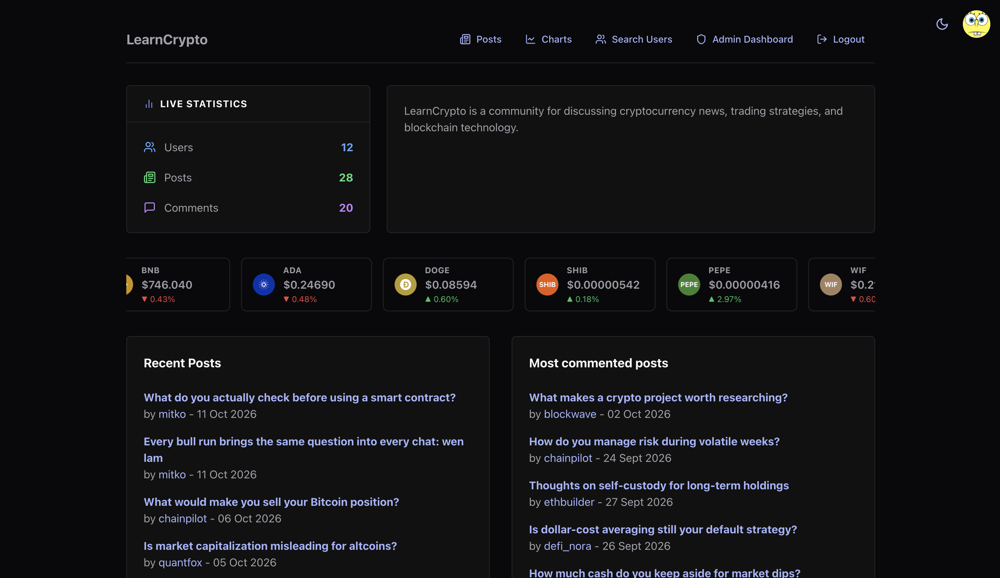
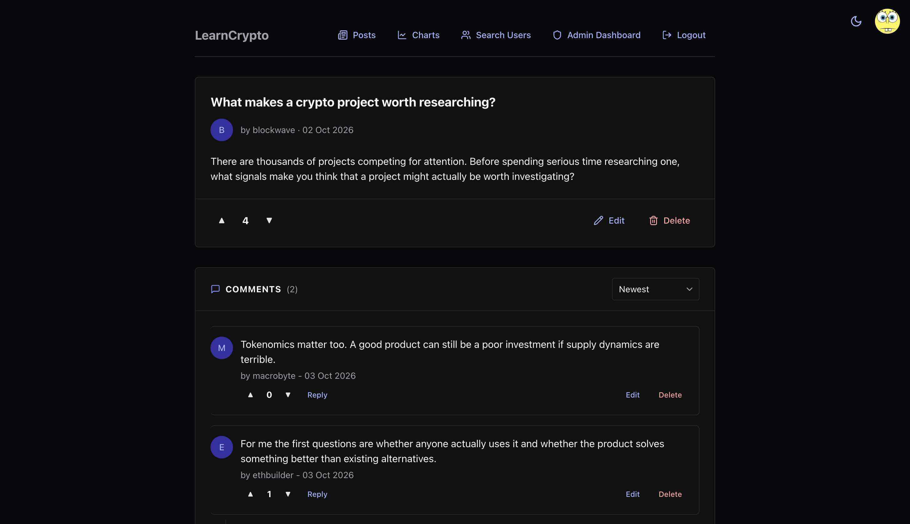
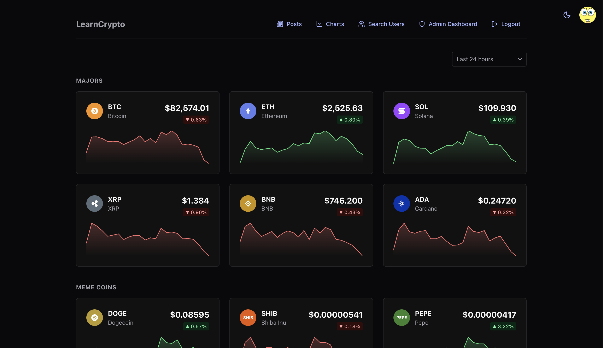
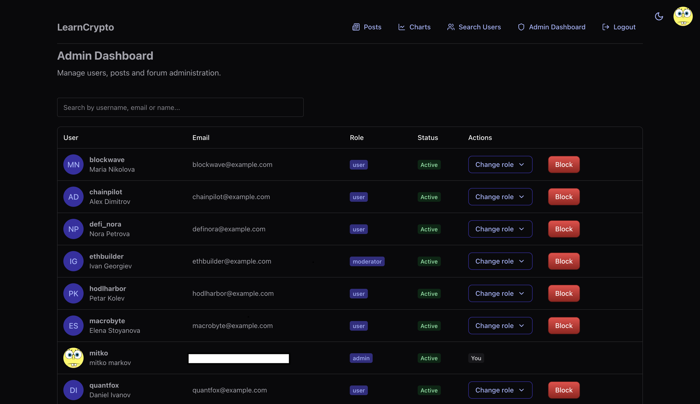

# LearnCrypto

A discussion forum for cryptocurrency, built as a single-page React
application on top of Supabase. Users register, write posts, hold
threaded discussions, vote, and follow live market prices; administrators
moderate the content and the accounts.

The project is a learning build: the data layer is Postgres with row level
security doing the authorisation, and the React app talks to it directly —
there is no server of our own in between.

## Features

**Accounts.** Email and password registration, login, password reset by
email, and profiles with avatar, location, gender and signature. Opening a
reset link does not sign anybody in: the password is changed first, and
the user then logs in with it.

**Posts.** Create, edit and delete, with validation on both sides — the
form checks the length after trimming, and the database enforces the same
limits as table constraints. Search by title, sort, and filter down to
your own posts.

**Comments.** Replies nest to any depth. Deleting a comment that has
replies keeps the thread readable by soft-deleting it; a comment with no
replies is removed outright.

**Voting.** Up and down votes on both posts and comments, one vote per
user per item.

**Administration.** A dashboard with user management (search, block,
unblock, change role) and post management (browse, filter by title or
author, sort, delete). Forum statistics live on the homepage.

**Market data.** A ticker and charts fed by Binance — live prices over a
WebSocket stream, historical candles over REST. Twelve coins, major and
meme, with hover tooltips on the charts.

**Theme.** Light and dark, with a custom Chakra UI theme.

## Stack

| Layer | Choice |
|---|---|
| UI | React 19, Chakra UI 3, React Router 7 |
| Build | Vite 8 |
| Backend | Supabase — Postgres, Auth, Storage, Realtime |
| Tests | Vitest 5, React Testing Library |
| Market data | Binance public WebSocket and REST API |

## Getting started

### Requirements

- Node.js 20.19 or newer (developed on 24.x)
- A Supabase project — the free tier is enough

### Install

```bash
git clone https://github.com/dimitarmarkovvv/learnCrypto.git
cd learnCrypto/crypto-forum
npm install
```

### Environment variables

Copy `.env.example` to `.env` and fill in both values from your Supabase
project, under **Project Settings → API**:

```
VITE_SUPABASE_URL=https://<your-project>.supabase.co
VITE_SUPABASE_KEY=<your anon public key>
```

Use the **anon** key, never the service role key. Anything in a `VITE_`
variable is bundled into the JavaScript the browser downloads, so the
service role key would be handed to every visitor. The anon key is safe
there because row level security decides what it may read and write.

### Run

```bash
npm run dev
```

The app starts on <http://localhost:5173>.

## Supabase setup

### 1. Run the SQL, in this order

The files live in `crypto-forum/database/` and are meant to be pasted into
the SQL editor in Supabase Studio. The order matters — policies reference
tables, triggers reference functions:

1. `scheme.sql` — tables, columns and constraints
2. `functions.sql` — the RPC functions (forum statistics, admin user
   search, block, promote)
3. `policies.sql` — row level security policies and column grants
4. `triggers.sql` — the profile-on-signup trigger and the `updated_at`
   triggers

### 2. Create the storage bucket

Create a **public** bucket named `avatars`. The policies in `policies.sql`
restrict writes to a folder named after the user's id, so a user can only
touch their own avatar; reads are public so the images can be displayed.

### 3. Configure auth

Under **Authentication → URL Configuration**, add the reset-password route
to the redirect allow list:

```
http://localhost:5173/reset-password
```

Email confirmation can stay on or off for local development. The reset
link lifetime is set under **Authentication → Emails**.

### 4. Create the first administrator

`promote_user` can only be called by somebody who is already an admin, so
the first one is made by hand. Register through the app, then run in the
SQL editor:

```sql
update public.profiles
set role = 'admin'
where username = '<your username>';
```

Every admin after that can be promoted from the dashboard.

## Scripts

Run from `crypto-forum/`:

| Command | What it does |
|---|---|
| `npm run dev` | development server |
| `npm run build` | production build into `dist/` |
| `npm run preview` | serve the production build locally |
| `npm run lint` | ESLint over the project |
| `npm test` | Vitest in **watch** mode — it keeps running |
| `npx vitest run` | the test suite once, which is what CI wants |

## Tests

34 tests across 9 files, covering the post forms and their validation,
authentication pages, route guards, and who is allowed to see the edit and
delete controls.

One thing to know when reading them: the service layer is mocked, so the
tests never reach the database. They prove that the interface hides
controls from people who should not press them. That the database *refuses
the action itself* is enforced by the row level security policies in
`policies.sql`, which these tests do not exercise.

## Project structure

```
crypto-forum/
├── database/          SQL run against Supabase, in the order above
└── src/
    ├── components/ui/ shared components, incl. admin/ and comments/
    ├── context/       the auth provider
    ├── hooks/         auth, comments, votes, live prices, price history
    ├── routes/        ProtectedRoute and AdminRoute
    ├── services/      every Supabase call lives here, by domain
    ├── views/         one file per page
    ├── utils/         date formatting, comment tree building
    └── theme.js       the Chakra theme: tokens, recipes, global styles
```

The rule the code follows: components never call Supabase directly. Every
query sits in `services/`, so there is one place to look when the data
layer changes.

## Security notes

Authorisation lives in the database, not in the interface. Hiding a button
is a convenience; the policy is the protection. Worth knowing:

- Blocked users keep read access and lose every write — posting, editing,
  deleting and voting.
- The `email` column of `profiles` is not readable by the client at all.
  Admins see emails through `admin_search_users`, a `security definer`
  function that checks the caller's role before it returns anything.
- There are three roles. A **user** owns only their own content. A
  **moderator** can edit and delete anybody's posts and comments, and
  nothing else — no dashboard, no blocking, no role changes. An **admin**
  can do all of that plus manage users and roles.
- For comments, the moderator update policy is what makes deletion work,
  because deleting a comment that has replies is an update.

## Known gaps

- The public posts list pages the query but has no previous/next controls,
  so only the first page is reachable there. The admin table has them.
- Sorting posts by comment count is not offered; it needs a SQL function,
  as PostgREST cannot order by an embedded aggregate.

## Screenshots

**Homepage** — forum statistics, the live price ticker, and the two feeds.



**A post and its thread** — the author's avatar, voting, and the comments
below, seen here by an administrator, who gets the edit and delete
controls on everybody's content.



**Charts** — prices arriving over the Binance WebSocket stream, drawn over
the candles fetched by REST, grouped into majors and meme coins.



**Admin dashboard** — user management, with the role menu and the block
control on every row except your own; post management sits below the fold.



## Team

| | |
|---|---|
| [@dimitarmarkovvv](https://github.com/dimitarmarkovvv) | Dimitar Markov |
| [@Lukanoid](https://github.com/Lukanoid) | |
| | Vasil Stamboliiski |

Work is tracked as GitHub issues, grouped into milestones from M1 through
M5.
